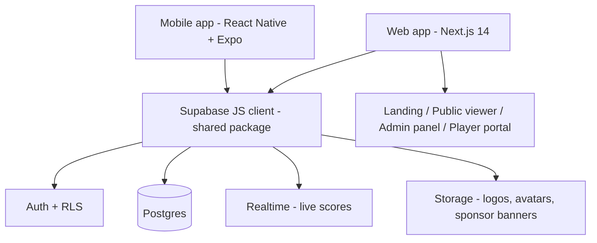
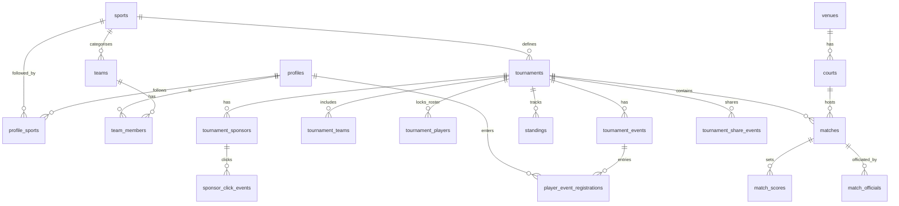

# Architecture

One Supabase backend powers the Next.js website and the Expo mobile app.

## Monorepo layout
| Path | Purpose |
|---|---|
| `apps/web` | Next.js: landing page, public tournament pages `/t/[slug]`, `/admin`, `/me` |
| `apps/mobile` | Expo Router app: sport picker, switcher, teams, tournaments, schedule |
| `packages/supabase` | SQL migration, typed client, API helpers |
| `packages/utils` | Round-robin + knockout generators, share URLs, event-limit helper |
| `packages/ui` | Shared design tokens |

## Data model (ERD)

## Key rules (enforced in Postgres)
- **One team per player per tournament**: `UNIQUE (tournament_id, player_id)` on `tournament_players`.
- **Event limit**: trigger `check_player_event_limit` blocks a player joining more than `tournaments.max_events_per_player` events (e.g. 2 of singles / doubles / mixed). Admins may override when `allow_admin_override` is on; overrides are flagged with a reason.
- **No court double-booking**: trigger `check_court_availability` rejects overlapping matches on the same court.
- **Sport-agnostic scoring**: `match_scores` stores one row per segment (set, half, quarter) with a label; `sports.score_type` drives the UI.
- **Roles**: `super_admin`, `tournament_admin`, `team_manager`, `player`. Public tables are readable by everyone; writes are admin-only (teams: creator or admin). Role changes are blocked for normal users.

## Roles
| Capability | Player | Team manager | Tournament admin | Super admin |
|---|---|---|---|---|
| View public tournaments, schedules, scores | ✓ | ✓ | ✓ | ✓ |
| Join events (within limit) | ✓ | ✓ | ✓ | ✓ |
| Create/manage own team | | ✓ | ✓ | ✓ |
| Create tournaments, schedule matches, enter scores | | | ✓ | ✓ |
| Manage sponsors, share links | | | ✓ | ✓ |
| Override event limit | | | ✓ | ✓ |
| Manage user roles | | | | ✓ |
